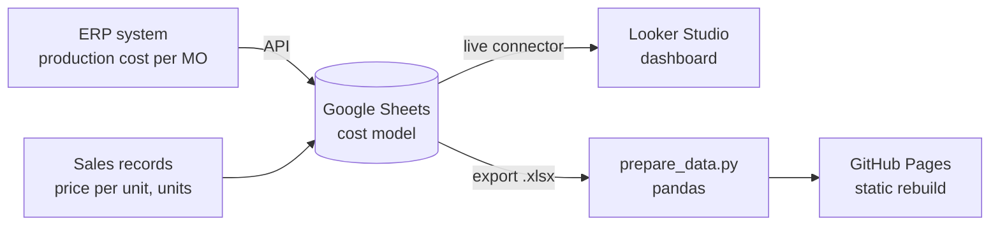

# Business Performance Dashboard

A live cost-tracking and profitability dashboard for a contract manufacturer. Production costs come from the company's **ERP through its API** into a **Google Sheets** cost model. **Looker Studio** then reports revenue, cost, gross profit and margin for every **manufacturing order (MO)**. Management uses it to set prices, track costs, catch production problems as they happen, and see which orders, products and clients make or lose money.


**▶ Looker Studio dashboard (September 2026):** [open the report](https://datastudio.google.com/u/0/reporting/27eedb84-68a2-4675-8c74-f4384aaaa08b/page/fxM4F?params=%7B%22df10%22:%22include%25EE%2580%25800%25EE%2580%2580IN%25EE%2580%258020260901%22%7D)

**▶ Interactive rebuild on GitHub Pages:** [https://ghorbanianhamed.github.io/business-performance-dashboard/](https://ghorbanianhamed.github.io/business-performance-dashboard/)


---

## At a glance

| | |
|---|---|
| Scope | 562 manufacturing orders · 15 clients · 25 products · 34 months (Jan 2024 – Oct 2026) · $55.4M revenue tracked |
| Stack | ERP API · Google Sheets · Looker Studio · Python/pandas · JavaScript/Chart.js |
| Audience | Finance, operations and sales management |
| Cadence | Live: the report reads the Google Sheet directly, so new orders appear as soon as they are recorded |

## Business impact

**Pricing.** Every order shows its price per unit next to its actual production cost per unit, so underpriced products stand out. Across the full history, three products had a *negative* median margin: PI-22 (−18%, average price $4.71 vs cost $5.66 per unit), PI-17 (−14%) and PI-19 (−5%). These became repricing candidates.

**Cost tracking and control.** Production cost is tracked per order, per unit and per process step, so cost changes are visible run by run instead of only in monthly totals.

**Finding production problems in real time.** Because the report updates as orders are recorded, a run that costs far more than normal shows up immediately as a red bar instead of at month end. Example: MO 5303 in September 2026 came in at **−156% gross margin**. Its cost was $8.21 per unit against a $3.21 price, while the four other runs of the same product that month cost $1.77–$2.03. That points to a yield or costing problem on that one run, not a pricing problem.

**Cost consistency.** Comparing runs of the same product shows how stable production is. PI-07's cost per unit ranged from $1.33 to $8.21 across 58 runs (coefficient of variation 59%), which flagged it for process review.

**Bottlenecks.** The Sheets cost model breaks the cost of each order down by process step (milling, blending, filling, labeling, cleaning and so on). The steps that add the most cost per unit are where efficiency work pays off first.

**Profitability by client.** Client A placed the most orders (212 MOs, $12.1M revenue) but earned a 22% margin, against 48% for Client D. This shaped contract and pricing conversations.

**Targets, fixed costs and break-even.** Each month is tracked against a 30% gross-margin target (7 of 34 months fell short). Gross profit is compared with the monthly fixed cost to show break-even coverage; in September 2026 it covered 228% of fixed cost. In total, 86 of 562 orders lost money, worth $559,763 of gross profit.

## Skills

### Google Workspace integration
- **Google Sheets as the data layer:** a relational-style cost model across several tabs: an order-level cost and revenue log, a monthly financial summary, a cost-per-process breakdown and an email-reminder tracker. Lookups join ERP cost to sales price per order, and formulas calculate unit cost, revenue, MO cost, gross margin, contribution margin and break-even.
- **Looker Studio:** connected live to Google Sheets, with calculated fields for gross profit, gross margin and margin tier, conditional colors by tier, a combo chart on three axes (profit bars, units line, unit-cost line), a tier donut, KPI scorecards, filter controls (Year, Month, Client, Product, MO#) and URL parameters that open the report on a given month.

### ERP API integration
- Production cost per manufacturing order comes from the ERP system through its API. Cost per unit includes materials, labor and overhead for each process step, plus an allowance for lab and retain samples.
- ERP records are matched to sales records by MO number, then cleaned and validated, for example by handling missing shipping dates and division-by-zero rows.

### Finance and cost accounting
- Cost tracking per order, per unit and per process step.
- Gross margin, contribution margin, fixed-cost coverage and break-even analysis.
- Pricing analysis: price per unit vs cost per unit, and repricing candidates.
- Profitability analysis by order, product, client and month, against a margin target.

### Analysis and reporting
- KPI design and executive dashboards: revenue, MO cost, gross profit, gross margin and margin tiers.
- Variance and consistency analysis of unit cost across runs of the same product.
- Root-cause analysis of loss-making orders: price vs cost, yield vs units shipped.
- Weekly and monthly financial reporting for management.

### This repository
- **Python/pandas** (`scripts/prepare_data.py`): reads the workbook, keeps completed orders, removes identifying fields and recomputes every metric.
- **JavaScript + Chart.js** (`index.html`, `assets/`): a static, responsive rebuild of the dashboard with linked filters, light and dark themes, and no backend.

## Data pipeline



## Metric definitions

| Metric | Definition |
|---|---|
| Revenue | Units produced × price per unit |
| MO cost | Units produced × ERP production cost per unit |
| Gross profit | Revenue − MO cost |
| Gross margin | Gross profit ÷ Revenue |
| Margin tier | **Highly profitable** GM > 30% · **Moderate margin** 0% ≤ GM ≤ 30% · **Unprofitable** GM < 0% |
| Fixed-cost coverage | Gross profit ÷ monthly fixed cost |

The rebuild reconciles with the Looker Studio report: September 2026 shows revenue **$3,228,327.83**, MO cost **$2,077,600.63**, gross profit **$1,150,727.20** and a **35.6%** margin, with 56.5% of orders highly profitable, 30.4% moderate and 13.0% unprofitable.

## Two versions

| | Looker Studio (original) | Static rebuild (this repo) |
|---|---|---|
| Built with | Google Sheets + Looker Studio | HTML, CSS, JavaScript, Chart.js, Python/pandas |
| Data | Live Google Sheets connection | Snapshot in `data/orders.csv` |
| Purpose | Day-to-day pricing, cost and margin decisions | Public, self-contained demo |

## Run it locally

```bash
# Open the dashboard (no build step)
open index.html            # or double-click it

# Rebuild the dataset from an exported workbook
pip install -r requirements.txt
python scripts/prepare_data.py path/to/workbook.xlsx
```

## Repository layout

```
index.html                 dashboard page (static rebuild)
looker.html                embedded Looker Studio report
assets/style.css           layout and light/dark theme
assets/app.js              filters, KPIs, charts, table
assets/data.js             generated dataset
data/orders.csv            same dataset as CSV
scripts/prepare_data.py    workbook → dataset
docs/                      screenshots
```

## Data privacy

Client names, product names, lot numbers and part numbers are replaced with codes (Client A, PI-07, SF-33 …). Only completed orders with both revenue and cost are published. The source workbook is never committed (`*.xlsx` is git-ignored).
