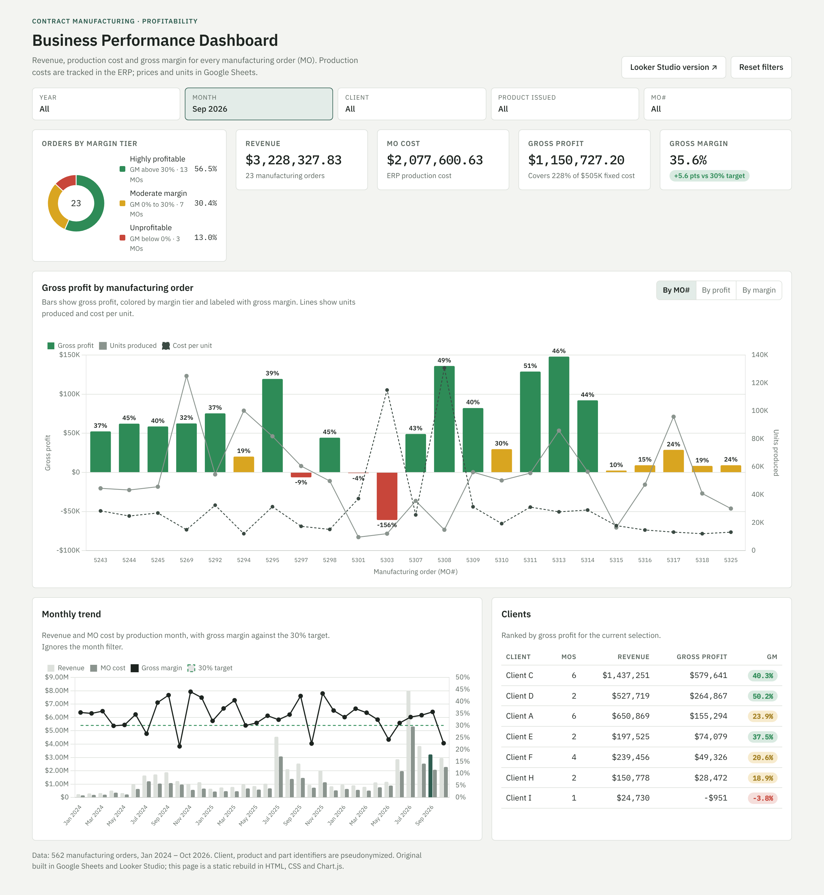
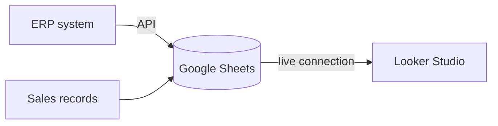

# Business Performance Dashboard

A live dashboard that tracks cost and profit for every manufacturing order. Production costs come from the ERP through its API into Google Sheets, and Looker Studio turns them into a report that management uses for pricing and cost decisions.

**▶ Looker Studio dashboard (September 2026):** [open the report](https://datastudio.google.com/u/0/reporting/27eedb84-68a2-4675-8c74-f4384aaaa08b/page/fxM4F?params=%7B%22df10%22:%22include%25EE%2580%25800%25EE%2580%2580IN%25EE%2580%258020260901%22%7D)

**▶ Interactive version:** [https://ghorbanianhamed.github.io/business-performance-dashboard/](https://ghorbanianhamed.github.io/business-performance-dashboard/)

---

## At a glance

| | |
|---|---|
| Scope | 562 orders · 15 clients · 25 products · 34 months · $55.4M revenue |
| Stack | ERP API · Google Sheets · Looker Studio |
| Users | Finance, operations and sales managers |
| Updates | Live, as soon as a new order is recorded |

## Business impact

- **Better pricing and contracts.** You can see each product's price next to its real cost, which helps set fair, reasonable prices and negotiate better contracts in the future.
- **Problems show up right away.** A bad production run shows up as a red bar the same day, not at month end. For example, one order cost $8.21 per unit against a $3.21 price, while other runs of the same product cost about $2.
- **Consistent costs.** Comparing runs of the same product shows which ones are unstable. One product's cost ranged from $1.33 to $8.21 per unit.
- **Finding bottlenecks.** Costs are broken down by process step, so it's clear where to focus efficiency work.
- **Knowing which clients pay off.** The biggest client by volume earned a 22% margin, against 48% for another.
- **Staying on target.** Every month is checked against a 30% margin target and against fixed costs to show break-even.

## How it works

## Data privacy

Client and product names are replaced with codes (Client A, PI-07 …), and the original workbook is not included in this repo.
